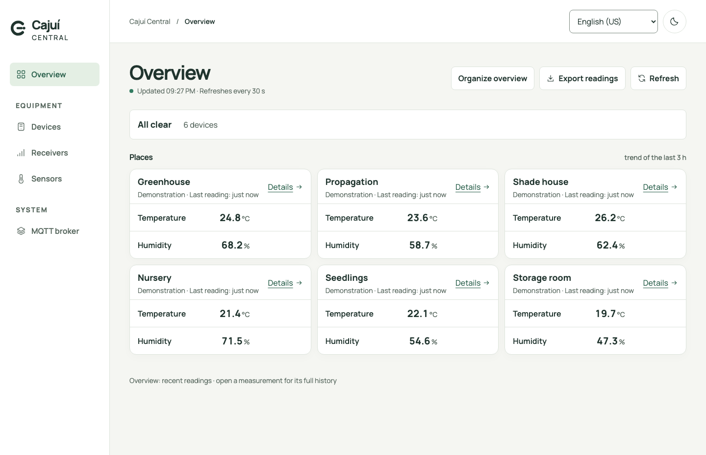
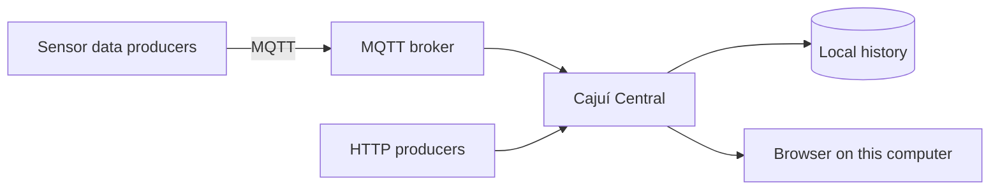

# Cajuí Central

English | [Português brasileiro](README.pt-BR.md)

**See what your sensors are measuring, keep their history, and find devices that need attention.**

Cajuí Central is a local monitoring application. Give devices and sensors useful
names, organize a dashboard, and inspect readings over time in your browser.
Your measurements stay in a SQLite database on the computer running Central.

It is the monitoring application for [Cajuí](https://github.com/cajui/docs), an
open-source sensor network designed around low-power transmitters and a receiver
built from a single supported LoRa board, without a commercial LoRaWAN gateway.
The project aims to support different sensor types and several sensors per
transmitter. The current reference firmware supports one climate sensor per
transmitter; its goal of months between charges still needs battery-life validation.

Central receives measurements through documented MQTT and HTTP contracts. New
sensor integrations must follow those contracts. Temperature and humidity are
used in the demo below as the first working example.



*Actual application with demonstration data. Names and measurements are fictional.*

[Try it](#try-it-without-hardware) · [Connect devices](#connect-your-devices) ·
[Documentation](#documentation) · [Contribute](CONTRIBUTING.md)

## What you can do

- Bring measurements from multiple devices and sensors together on one dashboard.
- Name devices and sensors, assign locations, and choose which measurements to show.
- Open history charts and browse original readings by date, including periods longer
  than 24 hours. Data has no automatic age-based deletion.
- Distinguish a sensor error from a device that stopped reporting. Inspect receiver
  connection state and readings waiting to reach the broker.
- Use English or Brazilian Portuguese, with light and dark themes.
- Receive data from Cajuí firmware or another producer using the documented MQTT
  or HTTP contracts.

Central is under active development. It provides monitoring and supported device
administration; actuator control and a general automation engine are not implemented.
The interface has no user login and must remain accessible only on the local computer.

## Try it without hardware

Install Docker with Compose v2. In a new directory, download the Compose file and
start Central with its included MQTT broker:

```sh
mkdir cajui-demo
cd cajui-demo
curl -fsSLO https://raw.githubusercontent.com/cajui/cajui-central/main/compose.yaml
docker compose pull
docker compose up -d --wait
docker compose run --rm demo
```

Open **http://127.0.0.1:8080**. In **Equipment → Devices → Add device**, select
`demo-device` and give it a name. Its temperature and humidity sensor appears on
the overview. Select a measurement to open its history.

The demo sends one simulated sample: **26.7 °C and 61.2% humidity**. Running it again
resends the same sample and does not create new history. With no further samples,
Central eventually reports the device as stale. The screenshot above uses several
simulated devices; this command starts with one.

Docker downloads the application and broker images and generates their credentials.
You do not need Go, Node.js, a frontend build, or any radio hardware. Images support
amd64 and arm64. The default image tag follows `main`.

The dashboard binds to this computer only. The broker accepts authenticated connections
on port 1883 of the local network and uses plaintext MQTT; use a trusted network.
See [installation](docs/installation.md) for ports and configuration.

To stop the stack, run `docker compose down`. Named volumes preserve readings and
credentials. **Adding `-v` deletes those volumes.** Back up the database before upgrades;
older binaries cannot open a newer database schema.

## Connect your devices



For Cajuí radio devices, the receiver forwards measurements to the broker. Use
**Equipment → Receivers → Add receiver** to obtain connection details and verify
that it comes online. Pair and name transmitters from the devices page when the
receiver supports those actions.

[Set up the complete Cajuí system](https://github.com/cajui/docs#build-your-first-sensor-link)
or [connect another MQTT producer](docs/mqtt.md#producers-on-the-local-network).
The receiver needs a broker address reachable on its network, which may differ from
Central's internal Docker address.

An existing broker also works. Home Assistant can subscribe to the same receiver
messages independently of Central. See [broker configuration](docs/mqtt.md#connecting-an-existing-broker)
and [Home Assistant integration](docs/mqtt.md#home-assistant-without-central).

## Documentation

| I want to… | Guide |
| --- | --- |
| Install, configure ports, or run from source | [Installation and configuration](docs/installation.md) |
| Organize the dashboard and understand history and status | [Interface guide](docs/interface.md) |
| Connect MQTT producers or Home Assistant | [MQTT and delivery contracts](docs/mqtt.md) |
| Send readings over HTTP | [HTTP API](docs/http-api.md) |
| Understand storage and design decisions | [Architecture decisions](docs/adr/0001-first-party-devices.md) · [History storage](docs/adr/0003-persisted-measurement-history.md) |
| Build and test changes | [Development](docs/development.md) · [Browser checks](docs/interface.md#frontend-development-checks) |
| Work on visual design or translations | [Brand and components](docs/brand/README.md) · [Localization](docs/localization.md) |

History uses arrival time at Central; it cannot reconstruct when a device measured
queued data. Large charts simplify the display, while the table retains original
readings. CSV export covers the recent overview data. See the interface guide for
these limits and database migration details.

## Contributing

Bug reports with reproduction steps, documentation corrections, translations and
code contributions are welcome. Read [CONTRIBUTING.md](CONTRIBUTING.md) before
starting a change. Report security issues through [SECURITY.md](SECURITY.md).

Central is part of [Cajuí](https://github.com/cajui/docs).
[Device firmware](https://github.com/cajui/cajui-firmware) lives in its own repository.

## License

[Apache-2.0](LICENSE).
