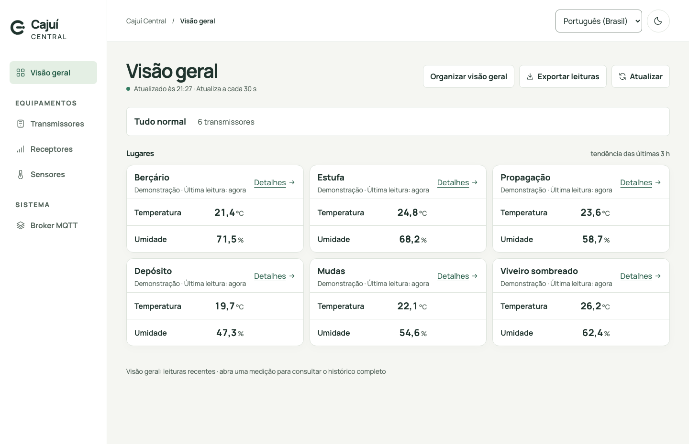
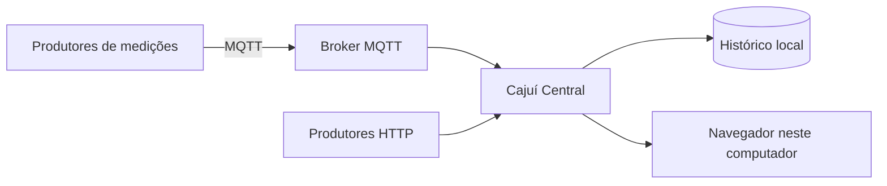

# Cajuí Central

[English](README.md) | Português brasileiro

**Acompanhe as medições dos seus sensores, consulte o histórico e encontre dispositivos que precisam de atenção.**

O Cajuí Central é uma aplicação local de monitoramento. Dê nomes aos dispositivos
e sensores, organize um painel e consulte as leituras ao longo do tempo pelo
navegador. As medições ficam em um banco SQLite no computador que executa o Central.

Ele é a aplicação de monitoramento do [Cajuí](https://github.com/cajui/docs/blob/main/README.pt-BR.md),
uma rede de sensores open source pensada para transmissores de baixo consumo e
uma receptora feita com uma única placa LoRa compatível, sem gateway LoRaWAN
comercial. O projeto busca atender diferentes tipos de sensor e vários sensores
por transmissor. O firmware de referência atual atende um sensor de clima por
transmissor; o objetivo de meses entre recargas ainda precisa de validação de autonomia.

O Central recebe medições pelos contratos MQTT e HTTP documentados. Novas
integrações de sensores precisam seguir esses contratos. Temperatura e umidade
aparecem na demonstração abaixo como o primeiro exemplo em funcionamento.



*Aplicação real com dados de demonstração. Nomes e medições são fictícios.*

[Experimentar](#experimente-sem-hardware) · [Conectar dispositivos](#conecte-seus-dispositivos) ·
[Documentação](#documentação) · [Contribuir](CONTRIBUTING.md)

## O que você pode fazer

- Reunir as medições de vários dispositivos e sensores em um painel.
- Nomear dispositivos e sensores, atribuir locais e escolher quais medições exibir.
- Abrir gráficos de histórico e consultar leituras originais por data, inclusive
  períodos maiores que 24 horas. Os dados não são apagados automaticamente por idade.
- Distinguir uma falha de sensor de um dispositivo que parou de enviar. Consultar
  a conexão dos receptores e as leituras aguardando envio ao broker.
- Usar português brasileiro ou inglês, com temas claro e escuro.
- Receber dados do firmware Cajuí ou de outros produtores que usem os contratos
  MQTT ou HTTP documentados.

O Central está em desenvolvimento ativo. Oferece monitoramento e as operações de
administração de dispositivos implementadas; controle de atuadores e um mecanismo
geral de automação ainda não existem. A interface não tem login e deve ficar
acessível apenas no computador local.

## Experimente sem hardware

Instale o Docker com Compose v2. Em uma pasta nova, baixe o arquivo Compose e
inicie o Central com o broker MQTT incluído:

```sh
mkdir cajui-demo
cd cajui-demo
curl -fsSLO https://raw.githubusercontent.com/cajui/cajui-central/main/compose.yaml
docker compose pull
docker compose up -d --wait
docker compose run --rm demo
```

Abra **http://127.0.0.1:8080**. Em **Equipamentos → Transmissores → Adicionar transmissor**,
selecione `demo-device` e dê um nome a ele. Seu sensor de temperatura e umidade aparece
na visão geral. Selecione uma medição para abrir o histórico.

A demonstração envia uma amostra simulada: **26,7 °C e 61,2% de umidade**. Executar
o comando novamente reenvia a mesma amostra e não cria novas leituras. Sem novas
amostras, o Central passa a indicar atraso no envio. A imagem acima usa vários
dispositivos simulados; esse comando começa com um.

O Docker baixa as imagens da aplicação e do broker e gera suas credenciais.
Você não precisa de Go, Node.js, compilação de frontend ou placas de rádio. As
imagens atendem amd64 e arm64. A tag padrão acompanha a `main`.

O painel fica acessível apenas neste computador. O broker aceita conexões
autenticadas na porta 1883 da rede local e usa MQTT sem criptografia de transporte;
use uma rede confiável. Consulte [instalação](docs/installation.md), em inglês,
para ajustar portas e configuração.

Para parar, execute `docker compose down`. Os volumes preservam leituras e
credenciais. **Acrescentar `-v` apaga esses volumes.** Faça backup do banco antes
de atualizar; binários antigos não abrem um esquema de banco mais novo.

## Conecte seus dispositivos



Nos dispositivos de rádio Cajuí, a receptora encaminha as medições ao broker.
Use **Equipamentos → Receptores → Adicionar receptor** para obter os dados de
conexão e verificar sua chegada. Faça o pareamento e nomeie transmissores pela
página de transmissores quando a receptora oferecer essas ações.

[Monte o sistema Cajuí completo](https://github.com/cajui/docs/blob/main/README.pt-BR.md#monte-seu-primeiro-enlace-de-sensores)
ou [conecte outro produtor MQTT](docs/mqtt.md#producers-on-the-local-network).
A receptora precisa de um endereço do broker acessível na rede dela, que pode
ser diferente do endereço interno usado pelo Docker.

Você também pode usar um broker existente. O Home Assistant pode consumir as
mensagens da mesma receptora independentemente do Central. Consulte a
[configuração do broker](docs/mqtt.md#connecting-an-existing-broker) e a
[integração com Home Assistant](docs/mqtt.md#home-assistant-without-central).

## Documentação

Os guias técnicos deste repositório estão em inglês. A
[documentação do ecossistema](https://github.com/cajui/docs/blob/main/README.pt-BR.md)
também está disponível em português.

| Quero… | Guia |
| --- | --- |
| Instalar, configurar portas ou executar pelo código-fonte | [Instalação e configuração](docs/installation.md) |
| Organizar o painel e entender histórico e estados | [Interface](docs/interface.md) |
| Conectar produtores MQTT ou Home Assistant | [MQTT e contratos de entrega](docs/mqtt.md) |
| Enviar leituras por HTTP | [API HTTP](docs/http-api.md) |
| Entender armazenamento e decisões de projeto | [Decisões de arquitetura](docs/adr/0001-first-party-devices.md) · [Armazenamento do histórico](docs/adr/0003-persisted-measurement-history.md) |
| Compilar e testar alterações | [Desenvolvimento](docs/development.md) · [Testes de navegador](docs/interface.md#frontend-development-checks) |
| Trabalhar no visual ou nas traduções | [Marca e componentes](docs/brand/README.md) · [Internacionalização](docs/localization.md) |

O histórico usa o horário de chegada ao Central; ele não reconstrói quando o
dispositivo mediu os dados que ficaram em fila. Gráficos grandes simplificam a
exibição, enquanto a tabela mantém as leituras originais. A exportação CSV cobre
os dados recentes da visão geral. O guia de interface explica esses limites e
as migrações do banco.

## Contribuições

Relatos de problemas com passos para reproduzir, correções na documentação,
traduções e contribuições de código são bem-vindos. Leia
[CONTRIBUTING.md](CONTRIBUTING.md) antes de começar. Relate questões de segurança
pelo procedimento de [SECURITY.md](SECURITY.md).

O Central faz parte do [Cajuí](https://github.com/cajui/docs).
O [firmware dos dispositivos](https://github.com/cajui/cajui-firmware) fica em outro repositório.

## Licença

[Apache-2.0](LICENSE).
